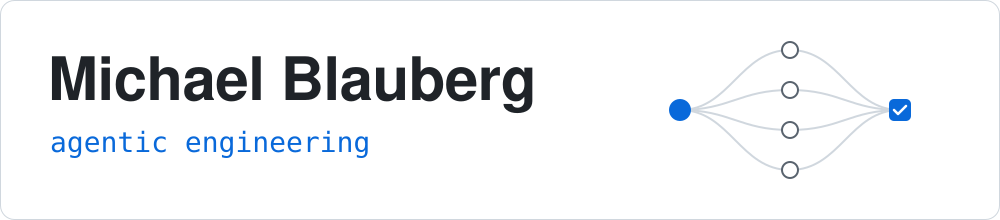

<picture>
  <source media="(prefers-color-scheme: dark)" srcset="assets/banner-dark.svg">
  
</picture>

I'm Technical Co-founder and Lead Engineer at App Stack Pty Ltd in Brisbane. I
lead development of [Sealle](https://sealle.com.au), practice management
software for accounting firms, and work across the whole product: frontend,
backend, data, cloud infrastructure and the delivery process around them.

I'm quick to pick up new tools where AI has changed how software gets built.
Coding agents are the biggest of those changes. They now write much of my code,
so a lot of my effort goes into what surrounds them: clear specs, fast tests,
review that scales with risk, and routing each task to a model that suits it.
That's why I built Provenant.

## Provenant

[**Provenant**](https://github.com/mblauberg/provenant) connects the coding
agents you already use so they can work together. It plugs into Claude Code,
Codex, Cursor, Agy and OpenCode, and lets a session in any of them hand tasks
to agents running on the others. There's no fixed pipeline to define up front:
the session you're talking to decides what to split up, which model suits each
piece and how much review a change needs. Routing pools change with one
command, so moving work onto a newer model doesn't change how you work.

- **Runs on your subscriptions.** It drives each provider's own CLI with your
  existing sign-in, so work draws on the plans you already pay for rather than
  per-token API billing. It tracks quota across several accounts and won't
  start a task on one that's run out.
- **Runs agents side by side safely.** Each task runs in a macOS sandbox that
  can write only to its own git worktree. Every run is recorded with its model,
  account, cost and output.
- **Connects sessions.** Fabric lets agent sessions, on one machine or several
  over SSH, send messages, share tasks and claim work.
- **Gives agents a shared playbook.** It installs 20 workflow skills (scoping,
  implementing, debugging, code review, releasing and more) and 8 skills for
  specific tools into every harness, so agents reuse the same practices across
  projects.

It's written in Rust and MIT-licensed. I use it day to day,
including to build Provenant itself.

## Selected projects

- [**PureMouse**](https://github.com/mblauberg/PureMouse): a lightweight,
  native replacement for Logi Options+ on macOS. It talks to Logitech MX mice
  directly over HID++ for button mapping, gestures, smooth scrolling, DPI and
  per-app settings, in under 20 MB of memory. Swift 6, with no third-party
  dependencies.
- [**RAG-as-a-Service**](https://github.com/mblauberg/rag-as-a-service): upload
  documents, ask questions about them and get answers that cite their sources.
  It combines Postgres keyword search with Qdrant vector search, merges the
  results with reciprocal rank fusion and reranks them with a cross-encoder.
  FastAPI and React services, containerised, with Kubernetes manifests.
- [**My Boardgame Collection**](https://github.com/mblauberg/my-boardgame-collection):
  a shared board game catalogue with personal libraries and curated shelves
  for finding games. React 19, TypeScript and Supabase, with passkey sign-in,
  row-level security and BoardGameGeek lookups. [Live on Vercel](https://my-boardgame-collection.vercel.app).
- [**Table tennis stroke classification**](https://github.com/mblauberg/table-tennis-ml-classification):
  classifies strokes from 6-axis IMU sensor data. Train and test sets are split
  by player, so no one appears in both, and the tuned random forest scores
  0.957 macro F1 on unseen players.

### Team projects

- **GlassChain**: a read-only blockchain wallet intelligence system, built as a
  TypeScript monorepo with CI and load testing and deployed on AWS. I designed
  its microkernel plugin architecture. (Private repo.)
- **Nova Edge**: an underwater glider simulator in Unreal Engine (C++) for
  Flying Fish Technologies. I built the physics: hydrodynamics, PID-controlled
  attitude and spring-damper cable towing. (Private repo.)
- [**Beast Breakout**](https://github.com/UQcsse3200/2024-studio-1): a Java and
  libGDX game built by more than 40 developers. I merged 19 pull requests
  covering NPC and boss AI, effects, refactoring and tests.

## Tools I use

TypeScript · React · TanStack · Rust · Swift · Python · PostgreSQL · Terraform ·
AWS · Cloudflare · Claude Code · Codex

I pick tools to suit the job and favour strict types and fast test runners,
because agents correct their own mistakes sooner when the compiler and tests
catch them.

---

[LinkedIn](https://www.linkedin.com/in/mblauberg/) ·
[Sealle](https://sealle.com.au) ·
[Provenant](https://github.com/mblauberg/provenant)
